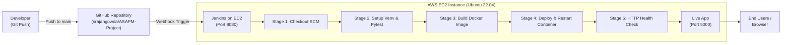

# 🚀 Complete CI/CD Pipeline with Jenkins on AWS EC2

This guide walks through deploying the **Student Exam Performance ML Application** on an **AWS EC2 Ubuntu instance** using an automated **Jenkins CI/CD Pipeline** triggered by GitHub webhooks.

---

## 🏛️ Architecture Overview



---

## 📋 Prerequisites
1. An active **AWS Account** (Free Tier or standard).
2. Your repository on GitHub: `https://github.com/srajangowda/ASAPM-Project.git`.
3. A local SSH client or AWS EC2 Instance Connect.

---

## Step 1: Provision the AWS EC2 Instance

### 1. Instance Specs
1. In the **AWS Management Console**, navigate to **EC2** > **Launch Instances**.
2. **Name**: `Jenkins-MLOps-Server`
3. **AMI**: `Ubuntu Server 22.04 LTS (HVM), SSD Volume Type` (64-bit x86).
4. **Instance Type**: `t2.medium` or `t3.medium` (2 vCPUs, 4GB RAM minimum for running Jenkins + ML Docker build).
5. **Key Pair**: Create a new key pair or select an existing `.pem` file.
6. **Storage**: Expand root volume to at least **25 GB** (GP3) to accommodate Docker images and Python wheels.

### 2. Configure Inbound Security Group Rules
Set up the firewall to allow SSH, Jenkins UI, and the Flask application:

| Type | Port Range | Protocol | Source | Purpose |
| :--- | :--- | :--- | :--- | :--- |
| **SSH** | `22` | TCP | `My IP` | Secure terminal access |
| **Custom TCP** | `8080` | TCP | `0.0.0.0/0` | Jenkins Web Dashboard & Webhook |
| **Custom TCP** | `5000` | TCP | `0.0.0.0/0` | Public Flask ML Application |

---

## Step 2: Server Initialization & Dependency Installation

Connect to your EC2 instance via SSH:
```bash
ssh -i /path/to/your-key.pem ubuntu@<YOUR-EC2-PUBLIC-IP>
```

Execute the following automated installation script to install **Java 17 (required by Jenkins)**, **Jenkins**, **Docker**, and **Python3-venv**:

```bash
#!/bin/bash
set -e

echo "=== 1. Updating System Packages ==="
sudo apt-get update -y && sudo apt-get upgrade -y

echo "=== 2. Installing OpenJDK 17 & Utilities ==="
sudo apt-get install -y openjdk-17-jdk curl wget gnupg lsb-release git python3-pip python3-venv

echo "=== 3. Installing Docker ==="
sudo apt-get install -y ca-certificates curl gnupg
sudo install -m 0755 -d /etc/apt/keyrings
curl -fsSL https://download.docker.com/linux/ubuntu/gpg | sudo gpg --dearmor -o /etc/apt/keyrings/docker.gpg
sudo chmod a+r /etc/apt/keyrings/docker.gpg

echo \
  "deb [arch="$(dpkg --print-architecture)" signed-by=/etc/apt/keyrings/docker.gpg] https://download.docker.com/linux/ubuntu \
  "$(. /etc/os-release && echo "$VERSION_CODENAME")" stable" | \
  sudo tee /etc/apt/sources.list.d/docker.list > /dev/null

sudo apt-get update -y
sudo apt-get install -y docker-ce docker-ce-cli containerd.io docker-buildx-plugin docker-compose-plugin
sudo systemctl enable docker
sudo systemctl start docker

echo "=== 4. Adding ubuntu user to docker group ==="
sudo usermod -aG docker ubuntu

echo "=== 5. Installing Jenkins ==="
sudo wget -O /usr/share/keyrings/jenkins-keyring.asc \
  https://pkg.jenkins.io/debian-stable/jenkins.io-2023.key
echo "deb [signed-by=/usr/share/keyrings/jenkins-keyring.asc] \
  https://pkg.jenkins.io/debian-stable binary/" | sudo tee \
  /etc/apt/sources.list.d/jenkins.list > /dev/null

sudo apt-get update -y
sudo apt-get install -y jenkins
sudo systemctl enable jenkins
sudo systemctl start jenkins

echo "=== 6. Granting Jenkins permissions to run Docker ==="
sudo usermod -aG docker jenkins
sudo systemctl restart docker
sudo systemctl restart jenkins

echo "=== Installation Completed Successfully! ==="
```

Save and run this script on the EC2 machine:
```bash
nano setup.sh
chmod +x setup.sh
./setup.sh
```

---

## Step 3: Initial Jenkins Web Configuration

1. Retrieve the initial administrator password:
   ```bash
   sudo cat /var/lib/jenkins/secrets/initialAdminPassword
   ```
2. Open your browser and navigate to:
   ```text
   http://<YOUR-EC2-PUBLIC-IP>:8080
   ```
3. Paste the password and select **Install suggested plugins**.
4. Create your Admin user (e.g., `admin` / your chosen password).
5. Verify the URL (`http://<YOUR-EC2-PUBLIC-IP>:8080`) and complete setup.

### Install Required Jenkins Plugins
1. Go to **Manage Jenkins** > **Plugins** > **Available plugins**.
2. Search and check:
   - **Docker**
   - **Docker Pipeline**
   - **GitHub Integration** (often pre-installed)
3. Click **Install** and check the box to restart Jenkins when done.

---

## Step 4: The Declarative Jenkins Pipeline (`Jenkinsfile`)

A production-ready `Jenkinsfile` is placed in the project root. It contains the following stages:

```groovy
pipeline {
    agent any

    environment {
        APP_NAME = "student-performance-app"
        APP_PORT = "5000"
        CONTAINER_PORT = "8080"
        IMAGE_TAG = "student-performance:${BUILD_NUMBER}"
        LATEST_TAG = "student-performance:latest"
    }

    stages {
        stage('Checkout Source Code') {
            steps {
                echo '=== Stage 1: Checking out code from GitHub ==='
                checkout scm
            }
        }

        stage('Set Up Environment & Run Tests') {
            steps {
                echo '=== Stage 2: Installing dependencies and running pytest ==='
                sh '''
                    # Create isolated Python virtual environment for test runner
                    python3 -m venv venv_ci
                    . venv_ci/bin/activate
                    pip install --upgrade pip
                    pip install -r requirements.txt
                    
                    # Run automated unit & integration tests
                    pytest -v
                    
                    # Clean up test environment
                    deactivate
                    rm -rf venv_ci
                '''
            }
        }

        stage('Build Docker Image') {
            steps {
                echo '=== Stage 3: Building Docker container image ==='
                sh """
                    docker build -t ${IMAGE_TAG} .
                    docker tag ${IMAGE_TAG} ${LATEST_TAG}
                """
            }
        }

        stage('Deploy Application Container') {
            steps {
                echo '=== Stage 4: Deploying container on EC2 ==='
                sh """
                    # Stop and remove existing running container if present
                    if [ \$(docker ps -q -f name=${APP_NAME}) ]; then
                        echo "Stopping running container ${APP_NAME}..."
                        docker stop ${APP_NAME}
                    fi

                    if [ \$(docker ps -aq -f name=${APP_NAME}) ]; then
                        echo "Removing previous container ${APP_NAME}..."
                        docker rm -f ${APP_NAME}
                    fi

                    # Run new container with port mapping
                    echo "Starting new container ${APP_NAME} on port ${APP_PORT}..."
                    docker run -d \\
                        --name ${APP_NAME} \\
                        --restart always \\
                        -p ${APP_PORT}:${CONTAINER_PORT} \\
                        ${LATEST_TAG}
                """
            }
        }

        stage('Health Check') {
            steps {
                echo '=== Stage 5: Verifying container health ==='
                sh """
                    sleep 10
                    STATUS=\$(curl -s -o /dev/null -w "%{http_code}" http://localhost:${APP_PORT}/ || true)
                    echo "Healthcheck HTTP Status: \$STATUS"
                    if [ "\$STATUS" -eq 200 ]; then
                        echo "Deployment successful and healthy!"
                    else
                        echo "Healthcheck failed with status \$STATUS"
                        exit 1
                    fi
                """
            }
        }
    }

    post {
        always {
            echo '=== Clean up dangling docker images ==='
            sh 'docker image prune -f || true'
        }
        success {
            echo "SUCCESS: Pipeline completed and application is running on port ${APP_PORT}!"
        }
        failure {
            echo "FAILURE: Build or deployment failed. Please check logs."
        }
    }
}
```

---

## Step 5: Configure the Jenkins Pipeline Job

1. From the Jenkins Dashboard, click **New Item**.
2. **Item Name**: `Student-Performance-Pipeline`
3. Select **Pipeline** and click **OK**.
4. In the Job Configuration:
   - **General**: Check **GitHub project** and enter:
     `https://github.com/srajangowda/ASAPM-Project/`
   - **Build Triggers**: Check **GitHub hook trigger for GITScm polling**.
   - **Pipeline**:
     - **Definition**: `Pipeline script from SCM`
     - **SCM**: `Git`
     - **Repository URL**: `https://github.com/srajangowda/ASAPM-Project.git`
     - **Branch Specifier**: `*/main`
     - **Script Path**: `Jenkinsfile`
5. Click **Save**.

---

## Step 6: Connect GitHub Webhook to Jenkins

To automatically trigger builds on `git push`:

1. Open your repository on GitHub: [github.com/srajangowda/ASAPM-Project](https://github.com/srajangowda/ASAPM-Project).
2. Go to **Settings** > **Webhooks** > **Add webhook**.
3. **Payload URL**:
   ```text
   http://<YOUR-EC2-PUBLIC-IP>:8080/github-webhook/
   ```
   *(Note: The trailing slash `/` is required).*
4. **Content type**: `application/json`
5. **Which events would you like to trigger this webhook?**: Select **Just the push event**.
6. Check **Active** and click **Add webhook**.
7. GitHub will display a green checkmark indicating successful delivery.

---

## Step 7: Testing the Pipeline & Accessing the Application

### 1. Manual Test Build
Click **Build Now** on your Jenkins pipeline page.
- Watch the build stages run:
  `Checkout SCM` ➔ `Run Tests` ➔ `Build Docker Image` ➔ `Deploy Container` ➔ `Health Check`.
- All stages should show green status.

### 2. Automated Git Push Test
Make any small commit and push to `main`:
```bash
git commit --allow-empty -m "Test automated Jenkins webhook deployment"
git push origin main
```
Jenkins will detect the webhook within seconds and run the entire pipeline automatically.

### 3. Open the Deployed App
Visit your application in any browser:
```text
http://<YOUR-EC2-PUBLIC-IP>:5000/
```
- **Prediction Studio**: `http://<YOUR-EC2-PUBLIC-IP>:5000/form`

---

## 🛠️ Troubleshooting & Production Tips

> [!TIP]
> **Issue: `permission denied while trying to connect to the Docker daemon socket`**
> Run:
> ```bash
> sudo usermod -aG docker jenkins
> sudo systemctl restart jenkins
> ```

> [!WARNING]
> **Issue: EC2 IP changes on reboot**
> By default, AWS EC2 public IPv4 addresses change when instances stop and start. Allocate an **Elastic IP** in AWS (EC2 > Elastic IPs) and associate it with your EC2 instance so your GitHub webhook URL and app URL remain permanent.
